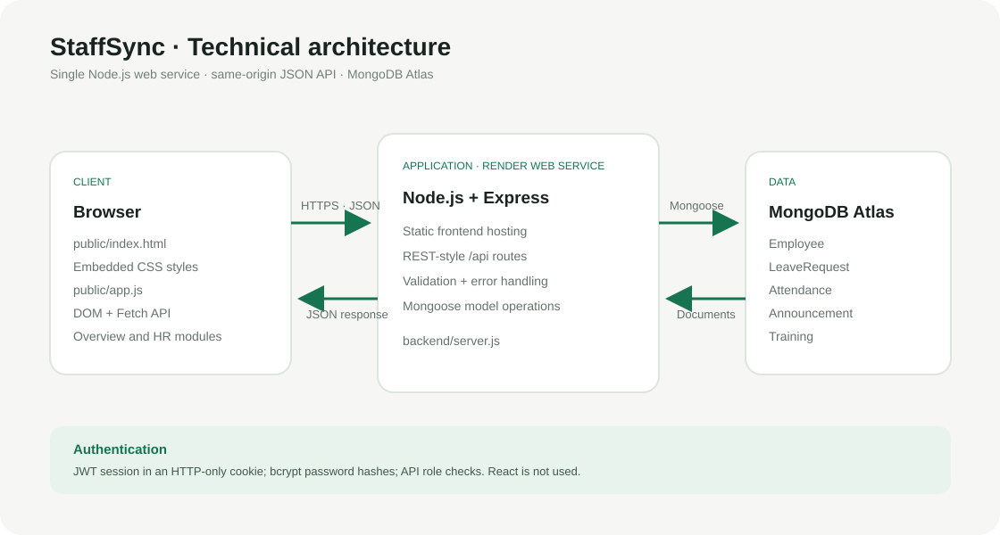
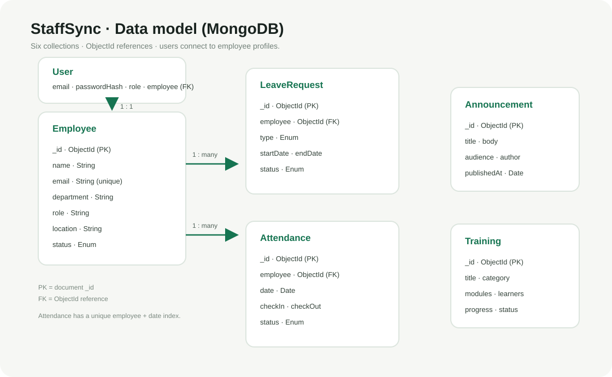

# StaffSync — Project Guide

## 1. Project overview

StaffSync is a web-based HR management demo. Its current implementation supports an employee directory, leave requests, attendance, announcements, and training records. The browser UI reads and writes data through an Express API, and MongoDB stores the records.

**Live demo:** [staffsync-icdg.onrender.com](https://staffsync-icdg.onrender.com)

### Implementation status

This guide describes the repository as it exists today. The app now supports registration/sign-in, bcrypt password hashes, signed JWT sessions in HTTP-only cookies, and basic role checks. It is **not yet** the full requested MERN specification: the client is plain HTML/CSS/JavaScript rather than React, and manager access is organization-wide rather than limited to an assigned team. Email verification, password reset, and automated security review are not included. Never enter real employee, health, payroll, or other sensitive data in this demo.

| Requested capability | Current project status |
|---|---|
| Employee, attendance, leave, announcements, training | Implemented with live MongoDB-backed API operations |
| HR, manager, employee roles | Implemented with server-side route checks; managers are not scoped to a team |
| User accounts | Implemented as a `User` collection; manager is a role, while notifications are not implemented |
| JWT, bcryptjs, protected routes | Implemented with HTTP-only cookie sessions and protected API routes |
| React, Axios, React Router, Redux Toolkit, Bootstrap/MUI | Not used; the frontend is vanilla HTML/CSS/JS |
| Input validation | Registration, selected route checks, and Mongoose validation; not comprehensive |
| Pagination, lazy loading, performance monitoring | Not implemented |

## 2. Project architecture

The app is deployed as one Node.js web service. Express serves `public/` and exposes `/api/*`; Mongoose connects the API to MongoDB Atlas. The browser JavaScript fetches JSON from the same origin and renders the dashboard.



### ER diagram

MongoDB stores six collections. User accounts reference one employee profile; leave requests and attendance records reference an employee by ObjectId. Training and announcement records are standalone documents.



### Features

- **Accounts:** employee registration/sign-in, sign-out, JWT-backed HTTP-only sessions, and role-specific API permissions.
- **People:** browse, search, filter, add, edit, and remove employee records.
- **Attendance:** check in/out, see today's attendance, inspect a 7- or 30-day trend, and export the current day's rows as CSV.
- **Leave:** submit requests, filter by status, approve or decline pending requests, and remove requests.
- **Announcements:** publish team news and remove announcements.
- **Learning and growth:** create courses, update progress/status, and remove courses.
- **Dashboard:** show counts and summaries computed from API data.
- **Health check:** `GET /api/health` reports API and database connection state.

### Roles and responsibilities (intended product model)

| Role | Intended responsibilities | Current enforcement |
|---|---|---|
| HR | Maintain employee records, attendance, leave workflows, announcements, reports | HR invitation code; HR-only employee and announcement changes |
| Manager | Review leave, oversee attendance, create/update training | Manager invitation code; access is organization-wide, not team-scoped |
| Employee | View own profile/attendance/leaves, check in/out, request leave, read announcements and training | Public employee registration; reads are limited to linked records |

### User flow

1. Register an employee account or sign in. HR/manager signup requires a valid invitation code configured by the site administrator.
2. The dashboard loads data allowed for the signed-in role. Employee accounts see only linked employee, leave, and attendance records.
3. Choose an available section from the sidebar and use allowed forms/actions. The browser sends a JSON request to the API.
4. Express validates selected inputs, Mongoose validates and stores the document, and the UI reloads its data.
5. The dashboard and section tables display the latest database values.

### MVC pattern

The code follows an MVC-like separation, though it is intentionally small and does not have separate controller/view folders:

- **Model:** Mongoose schemas in `backend/models/` define fields, validation, timestamps, references, and the attendance uniqueness index. `User` stores a bcrypt password hash, role, and employee reference.
- **Controller/API logic:** route handlers in `backend/server.js` process requests, query models, and return JSON.
- **View:** `public/index.html` contains page markup and dashboard inline CSS; `public/auth.css` styles account screens; `public/app.js` handles interaction, API calls, and rendering.

## 3. Project setup and configuration

### Folder structure

```text
StaffSyncproject/
├── backend/
│   ├── models/             # MongoDB/Mongoose schemas, including User
│   ├── seed.js             # Synthetic starter data for empty collections
│   └── server.js           # Express API and static-file server
├── docs/                   # Project guide and diagrams
├── public/
│   ├── index.html          # Page markup and embedded dashboard CSS
│   ├── auth.css            # Sign-in and registration styles
│   └── app.js              # Browser logic, account flow, and API integration
├── .env.example            # Safe environment-variable template
├── package.json
└── render.yaml             # Render web-service configuration
```

### Client setup

There is no separate React build or client package. Express serves the static frontend from `public/`. Dashboard CSS is inside the `<style>` block in `public/index.html`; sign-in/register styles are in `public/auth.css`; browser behavior is in `public/app.js`.

### Server setup

The API uses Express and Mongoose. `backend/server.js` loads environment variables, serves static files, registers JSON middleware and API routes, connects to MongoDB, then listens on `PORT` (default `5000`). `npm start` starts the production server; `npm run dev` starts it with Nodemon.

## 4. Backend development

### Backend structure and request handling

The route handlers in `backend/server.js` call Mongoose models directly. A shared async wrapper forwards errors to the error middleware. The API returns JSON; not-found routes return 404, validation errors return 400, duplicate records return 409, and unexpected failures return a generic 500 response.

| Area | Main routes |
|---|---|
| Health | `GET /api/health` |
| Authentication | `POST /api/auth/register`, `POST /api/auth/login`, `POST /api/auth/logout`, `GET /api/auth/me` |
| Employees | `GET/POST /api/employees`, `GET/PATCH/DELETE /api/employees/:id` |
| Leaves | `GET/POST /api/leaves`, `PATCH/DELETE /api/leaves/:id` |
| Attendance | `GET /api/attendance`, `GET /api/attendance/trend`, `POST /api/attendance/check-in`, `PATCH /api/attendance/:id/check-out` |
| Announcements | `GET/POST /api/announcements`, `DELETE /api/announcements/:id` |
| Training | `GET/POST /api/training`, `PATCH/DELETE /api/training/:id` |

### Backend development explanation

The frontend's `api()` helper sends same-origin `fetch()` requests. The server maps each resource route to a Mongoose model operation. List endpoints return sorted documents; leave and attendance queries populate the employee's display fields. Employee deletion also removes that employee's leave and attendance records. Check-in uses a unique `{ employee, date }` index to reject a second daily check-in for the same employee.

## 5. Database development

### Configure MongoDB Atlas

1. Create a MongoDB Atlas cluster and database user.
2. Allow the deployed Render service to reach the cluster through Atlas network access settings. For a college demo, keep access limited where practical; do not publish the database password or connection URI.
3. Copy `.env.example` to `.env` for local development and set `MONGODB_URI` to the private Atlas connection string. `.env` is ignored by Git.
4. In Render, set `MONGODB_URI`, `HR_REGISTRATION_CODE`, and `MANAGER_REGISTRATION_CODE` as private environment variables on the StaffSync service. The Blueprint generates `JWT_SECRET`. Never commit or paste secrets into the guide. Missing invitation codes disable privileged signup, while employee signup remains available.

### Connection and collections

`mongoose.connect(process.env.MONGODB_URI)` runs before the HTTP server begins listening. The database name is selected by the database portion of the Atlas URI. Mongoose creates collections when records are first stored.

| Collection/model | Key fields and relationships |
|---|---|
| `User` | Name, unique email, bcrypt password hash, role, employee reference |
| `Employee` | Name, unique email, department, role/title, location, status |
| `LeaveRequest` | Employee reference, type, start/end dates, reason, status, reviewer fields |
| `Attendance` | Employee reference, date, check-in/out, location, status; unique employee/date index |
| `Announcement` | Title, body, audience, author, publication date |
| `Training` | Title, category, modules, learners, progress, status |

Manager and HR accounts use the `User` role field; there is no separate `Manager` collection. A `Notification` collection is not implemented.

### Seed data

`npm run seed` adds synthetic sample employees, leave requests, announcements, and training only when each corresponding collection is empty. It does not clear collections. The sample records are fictional; keep demo data fictional.

## 6. Frontend development

### Frontend structure

`public/index.html` holds the responsive single-page interface and its original embedded CSS. `public/auth.css` styles the account gate. `public/app.js` contains registration/sign-in, role-aware navigation, DOM rendering, form handling, API requests, and CSV export. There is no React, React Router, Axios, Redux Toolkit, Bootstrap, or Material UI in the current source.

### Development and explanation

On page load, the client checks `/api/auth/me`. After registration or sign-in, the server sets an HTTP-only signed JWT cookie and the client loads data allowed for that role. Navigation toggles visible panels. Create/edit dialogs submit forms to the relevant endpoint. Leave decisions, attendance actions, and training progress updates call their resource endpoints and refresh the displayed data.

The page is responsive and role-aware, but uses one shared dashboard rather than separate HR, manager, and employee dashboard designs.

## 7. Project execution

### Run locally

Requirements: Node.js/npm and a MongoDB Atlas database URI.

```bash
git clone https://github.com/nayanpatidar901/StaffSyncProject.git
cd StaffSyncProject
npm install
```

Copy `.env.example` to `.env` and set `MONGODB_URI` plus a long random `JWT_SECRET`. Optional private `HR_REGISTRATION_CODE` and `MANAGER_REGISTRATION_CODE` values enable privileged signup. The first employee account does not need an invitation code. Then run:

```bash
npm run seed   # optional; adds samples to empty collections
npm run dev
```

Open `http://localhost:5000`. The deployed version uses Render and the same-origin API; public demo: [staffsync-icdg.onrender.com](https://staffsync-icdg.onrender.com).

### Screenshots and demo video

The live dashboard is available at the public demo link above. The repository currently has no checked-in screenshot files or recorded demo video. Capture genuine screenshots from the live or local app and place them in `docs/screenshots/` (for example `overview.png`, `people.png`, `attendance.png`, `leave-requests.png`, and `learning-announcements.png`). Do not use real personal data in submitted screenshots.

Suggested short demo recording: register an employee account and sign out; sign back in and show the employee's own leave and attendance view; then, using a manager/HR account with an invitation code, show its role-specific dashboard actions. Use fictional data only. Add the finished video to the repository or link it from this section after recording.

## 8. Testing, security, and optimization status

The project has no automated test suite in the current repository. Suggested manual review areas are registration validation, sign-in/sign-out/session expiry, employee access limits, role invitation codes, employee CRUD, attendance duplicate prevention and checkout, leave transitions, announcement/training CRUD, dashboard refresh, and API/database health.

**Security limitation:** the app protects data APIs behind sign-in, stores bcrypt password hashes, uses HTTP-only JWT cookies, and applies basic role authorization. It does not verify email addresses or support password recovery; managers are not limited to an assigned team; rate limiting and formal security testing are absent. It remains a portfolio demo, not production HR software. Do not use real employee, health, or payroll data.

Existing optimization: email uniqueness and a compound employee/date attendance index. Pagination, lazy loading, centralized role checks, and performance monitoring are not implemented.

## 9. Next steps for the full requested scope

1. Add email verification and safe account activation for HR-created employee records.
2. Add team membership and enforce manager team boundaries.
3. Build separate dashboards; if a React migration is required, add React Router and a state/data layer, then configure production builds and API URLs.
4. Add notifications, pagination, comprehensive validation, automated tests, and deployment/security monitoring.
5. Review the live deployment and database network rules before presenting the expanded system as secure or production-ready.
